# Project Documentation

## 1. Project Title and Student Details
**Student Performance Analytics System**
Name: `[YOUR NAME]` · Roll/Enrollment No.: `[YOUR ID]` · Course: EWB Python with AI · Date: `[DATE]`

## 2. Objective
Build an individual Python data-analysis project that reads student data and produces totals, averages, grades, pass/fail statistics, subject-wise performance, highest/lowest performance and top students, with an interactive Streamlit interface and safe handling of bad data.

## 3. Technologies Used
Python (variables, loops, functions, conditions), NumPy (marks matrix, row sums, mean, median, correlation, masks), Pandas (DataFrames, `read_csv`, `groupby`, filtering, `to_csv`), Streamlit + Plotly (interface and charts), Pytest (testing).

## 4. Dataset Description
`data/students.csv`: 26 fictional students in four departments (Computer Science, Data Science, Electronics, Information Technology). Columns: Student_ID, Name, Department, Python, Statistics, NumPy, Pandas, Data_Analysis, Attendance. It deliberately includes boundary cases (averages of exactly 40, 50, 60, 70, 80 and 90), a student who fails on one subject despite an average above 40 (S009), a subject mark of exactly 35 (S023), grade-F students who still pass (S011, S026), ten students below 75 % attendance, and high and low performers.

## 5. Implementation
- **`functions.py`** – the only place where calculations happen. Loading: `load_dataset` (decode, structure checks) → `_validate` (columns, values) → `ValidationResult`. Analysis: `analyze` builds a NumPy marks matrix, sums rows, calls `assign_grade` and `is_passing` for each student. Reports: `summary_metrics`, `subject_stats`, `department_stats`, `attendance_stats`, `grade_distribution`, `top_students`, `needs_attention`, `reconciliation_check`, `filter_students`, `build_summary_report`.
- **`app.py`** – nine pages that call those functions. The validated dataset is held in `st.session_state`; an upload replaces it only after validation and a button click, and "Return to bundled dataset" restores the default.
- **`main.py`** – command-line report (`--file`, `--export`) using the same engine.
- **Loops:** per-student grading, per-subject statistics, per-column validation. **Conditionals:** grade bands, pass rule, validation, empty states. **Variables/types:** `main.py` shows `int`, `float`, `str`, `bool` values.
- **Validation** reports all problems together and never converts invalid values to zero. It rejects: unreadable/empty/binary files, `;`-separated files, rows with the wrong number of fields, missing or repeated required columns, empty IDs/names/departments, missing or non-numeric marks, marks or attendance outside 0–100, and duplicate IDs (ignoring case). It accepts but *warns* about: Windows-1252 text, differently capitalised headers, and extra or pre-calculated columns.

## 6. Key Features
See README sections 5–6. Ties are handled for top students, highest/lowest performers, best/lowest subjects and best department.

## 7. Output / Screenshots
Captured from the running application with headless Chromium (`tools/capture_and_verify.py`).

| | |
|---|---|
|  | 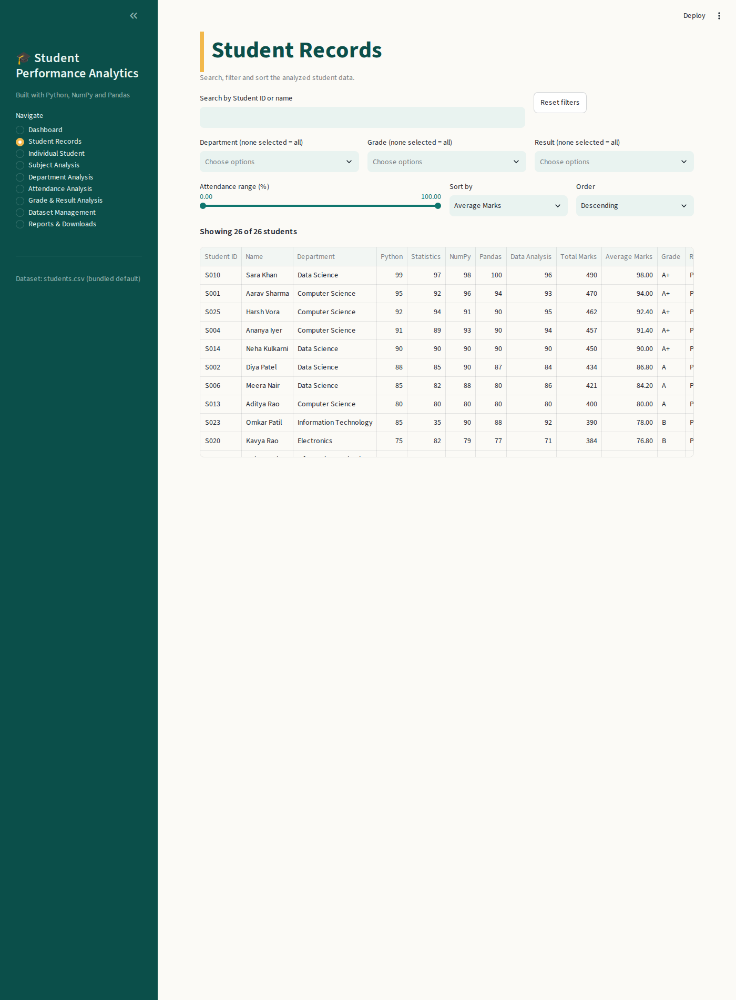 |
| 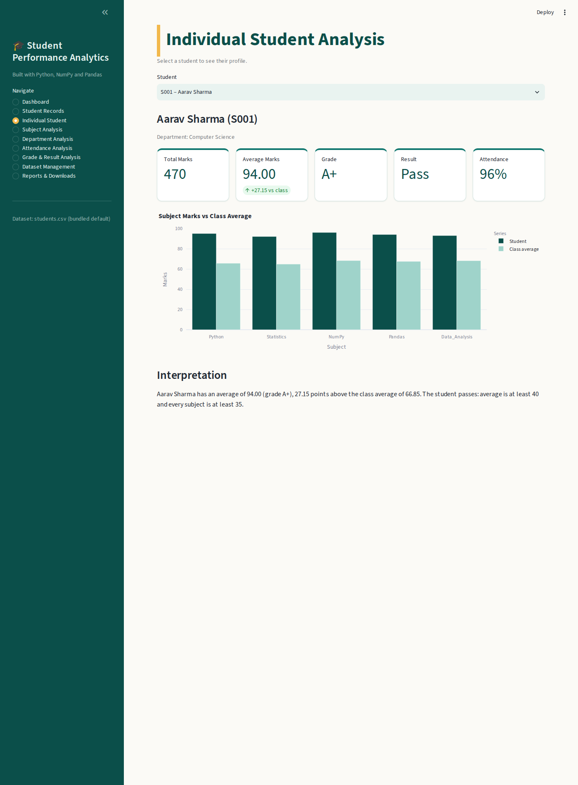 | 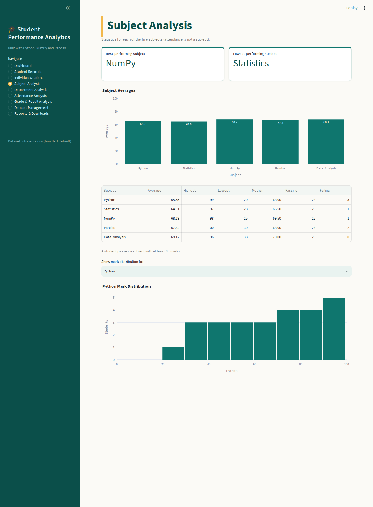 |
| 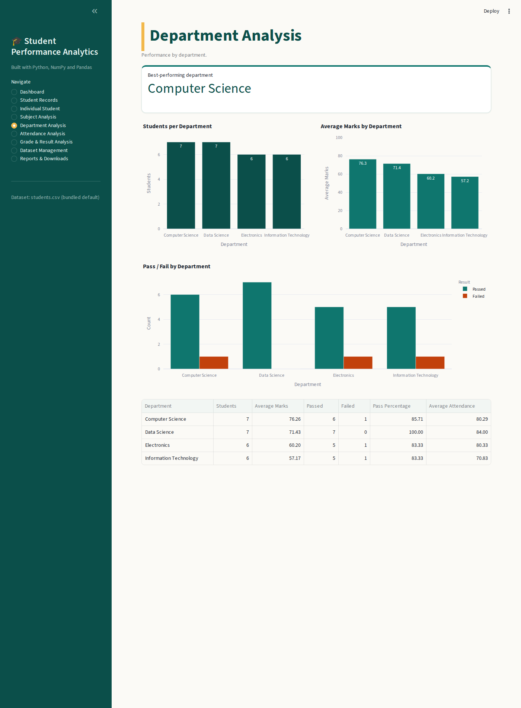 | 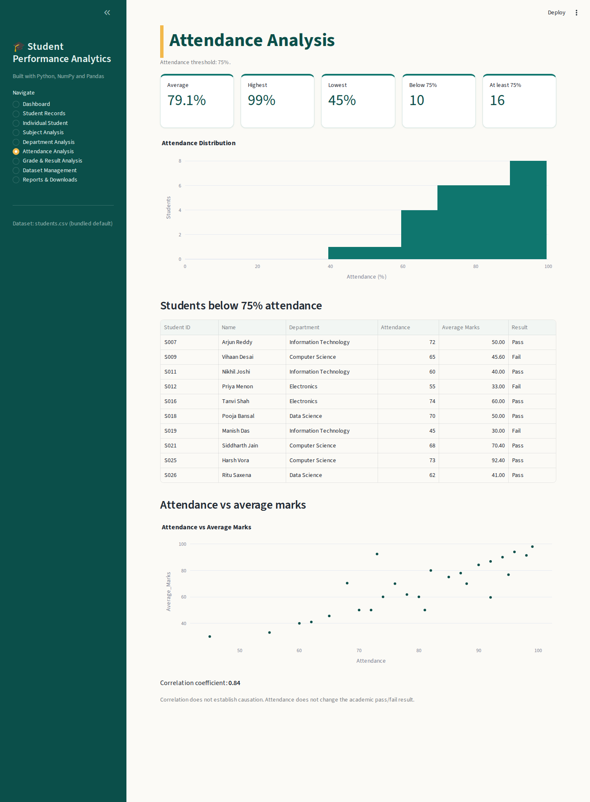 |
| 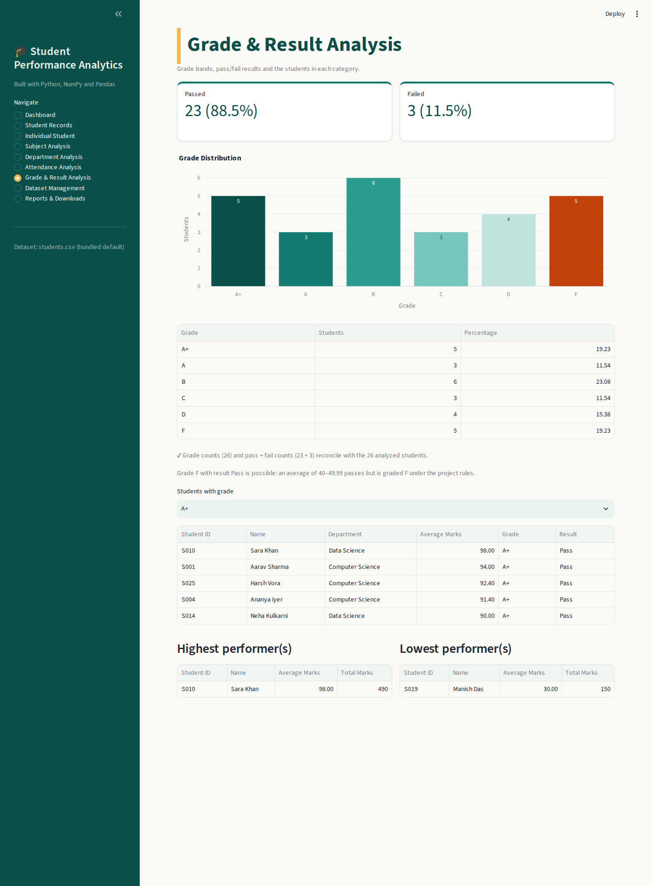 | 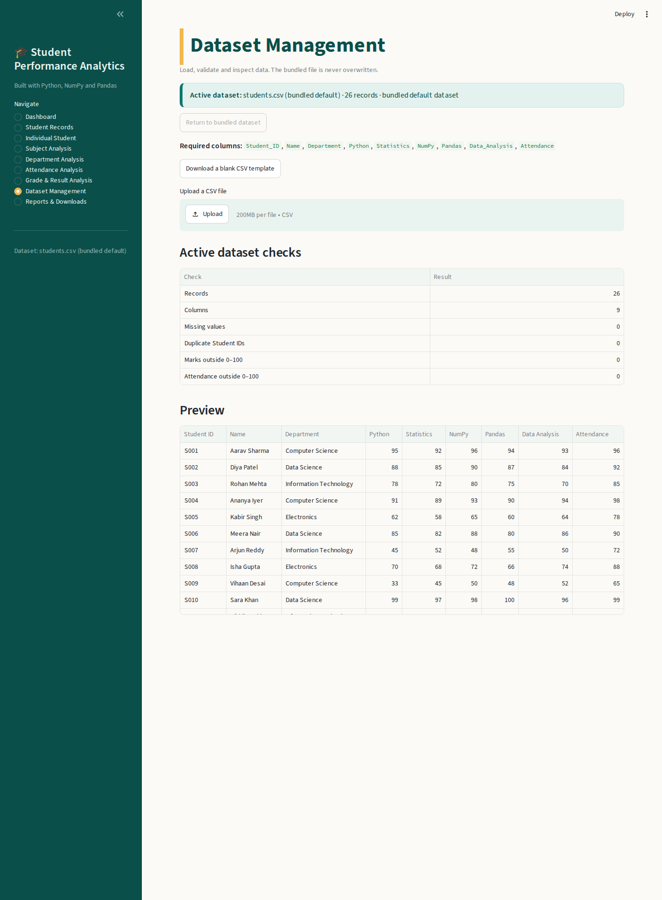 |
| 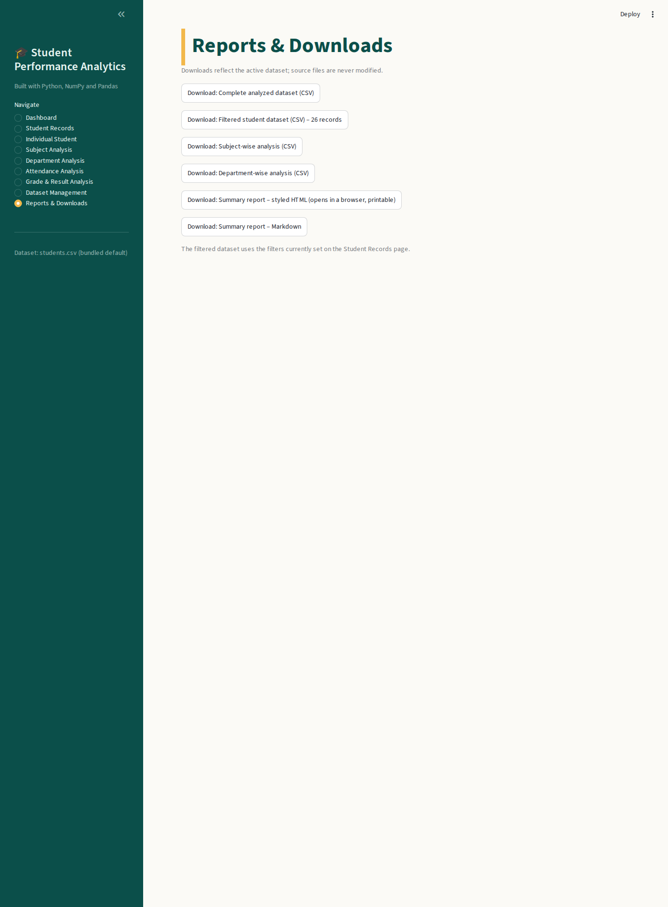 | 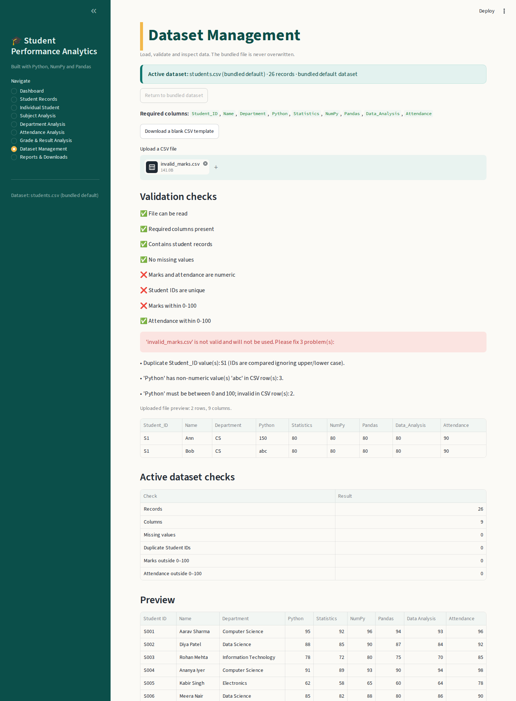 |
| 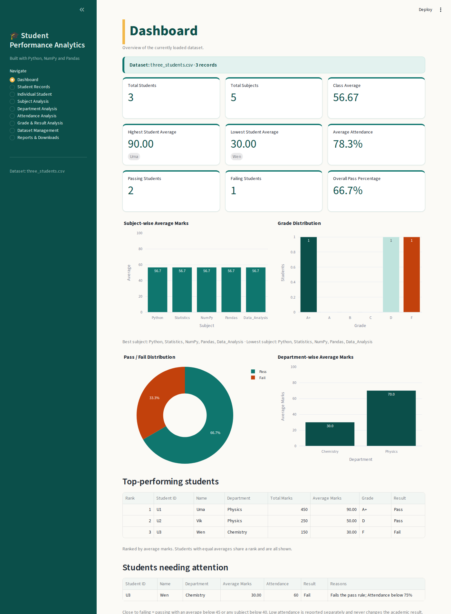 | 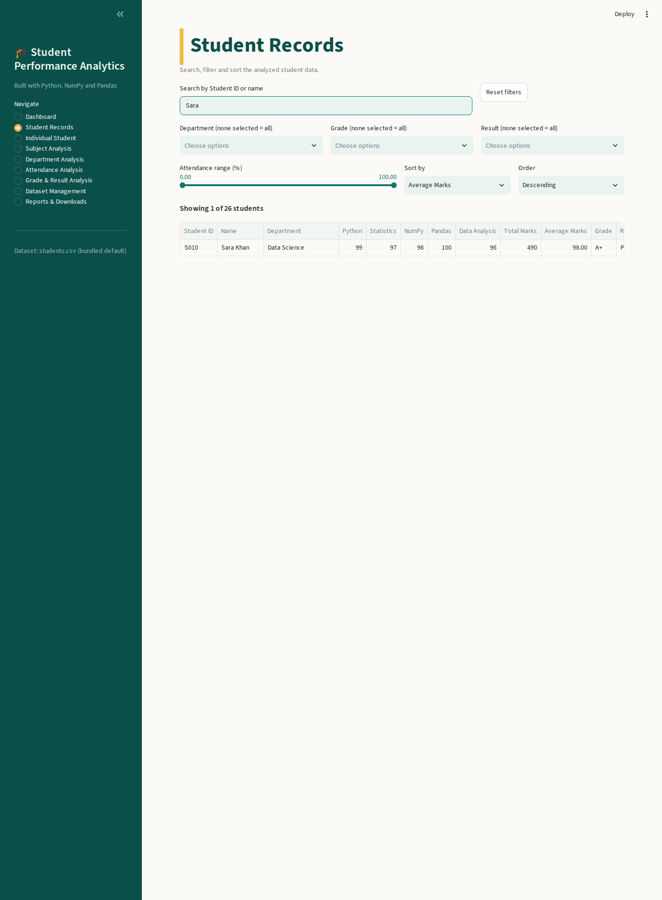 |
| 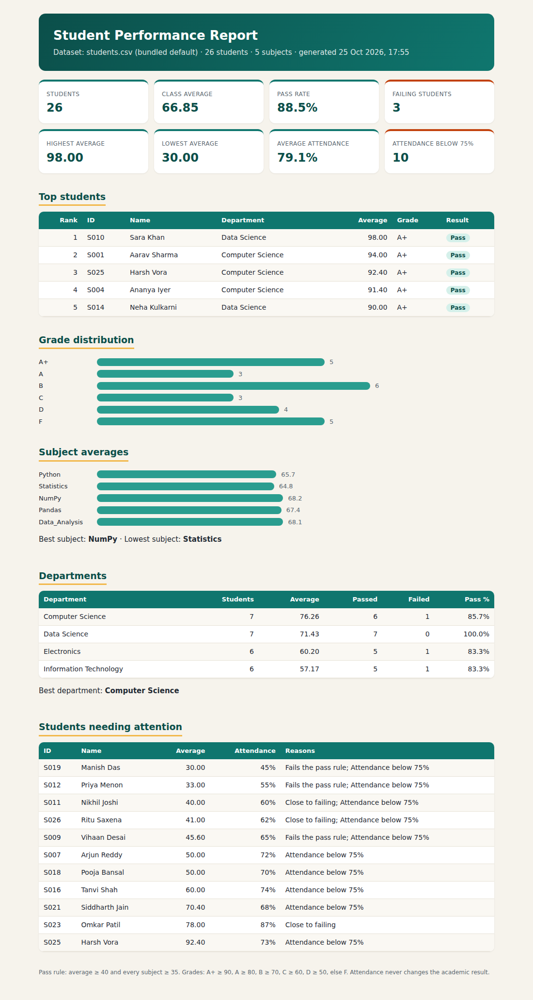 | |

Screenshot 11 uses a small three-student test file, not the bundled data.

## 8. Final Outcome
A working, tested application. Results on the bundled data (verified by the test suite and in the browser): 26 students, class average 66.85, 23 pass / 3 fail (88.5 % / 11.5 %), grades A+ 5 · A 3 · B 6 · C 3 · D 4 · F 5, best subject NumPy (68.23), lowest subject Statistics (64.81), best department Computer Science (76.26), top student Sara Khan (98.00), lowest Manish Das (30.00), average attendance 79.1 %, ten students below 75 %.

## 9. Challenges & Learning
`[Write your own experience here.]` Real points from this project you could discuss: why a pandas CSV read can silently shift columns when every row has an extra field (and how counting fields per row prevents it); deciding that an average of 40–49.99 is grade F but still a pass; why blanks must never become zero; keeping Streamlit filters when moving between pages.

## 10. GitHub Repository
`[PASTE REPOSITORY URL HERE]`
