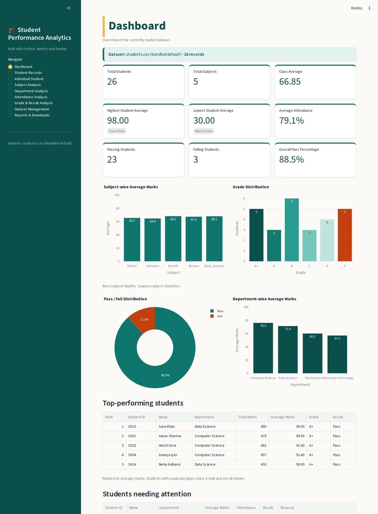
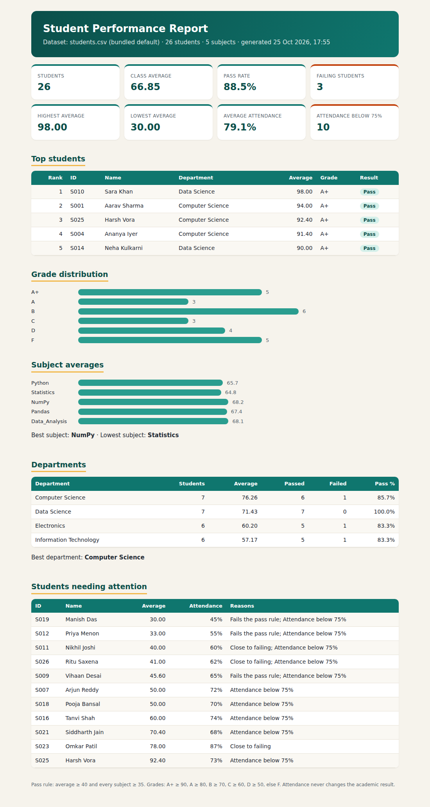

# Student Performance Analytics System

*An interactive academic performance analysis dashboard built with Python, NumPy, and Pandas.*


()

## 1. Overview
A local, browser-based Streamlit application that reads student marks from a CSV file, validates it, and reports totals, averages, grades, pass/fail statistics, subject / department / attendance analysis, top performers and students needing attention. All calculations live in `functions.py`; `app.py` (GUI) and `main.py` (command line) only call them.

## 2. Problem statement
Teachers need a quick, reliable way to turn raw marks into meaningful insight without manual spreadsheet work, and need to be told clearly when a data file is wrong instead of getting misleading numbers.

## 3. Objectives
Practise variables, loops, functions, conditionals, NumPy and Pandas; compute the required metrics correctly; reject bad data safely; present results in an easy-to-use interface.

## 4. Technologies used
Python 3.10+ (tested on 3.12), NumPy, Pandas, Streamlit (interface), Plotly (charts), Pytest (tests). Optional: Playwright (only for `tools/capture_and_verify.py`).

## 5. Project features
- Nine interactive pages, all driven by one calculation engine.
- **Safe CSV upload:** every file is checked (8-point checklist) before use; *all* problems are listed together with CSV row numbers; invalid data is never used and blanks are never turned into zero.
- Tolerant of real-world files: Excel BOM, Windows-1252 text (with a warning), headers in any capitalisation (`student id` → `Student_ID`, with a warning); strict about wrong field counts, repeated columns, `;`-separated files and duplicate IDs (case-insensitive).
- Search / filter / sort, per-student profile with plain-language interpretation, students-needing-attention table, six downloads (4 CSV, styled HTML report, Markdown report), blank CSV template, command-line report.

## 6. GUI pages
| Page | Purpose |
|---|---|
| Dashboard | 9 metric cards (highest/lowest show the student), 4 charts, top 5 students (ties share a rank), students needing attention |
| Student Records | Search by ID/name; filter by department, grade, result, attendance; sort; reset; match count |
| Individual Student | Profile, subject chart vs class average, interpretation |
| Subject Analysis | Average / highest / lowest / median / passing / failing per subject; distribution chart |
| Department Analysis | Students, average, pass/fail, pass %, best department (ties handled) |
| Attendance Analysis | Statistics, students below 75 %, distribution, attendance-vs-marks scatter (correlation ≠ causation) |
| Grade & Result Analysis | Grade and pass/fail counts, reconciliation check, students per grade, highest/lowest performers |
| Dataset Management | Bundled data, upload, validation checklist, warnings, preview, return to bundled data |
| Reports & Downloads | 4 CSV files, a colour-styled printable **HTML summary report**, and a Markdown summary |

## 7. Dataset schema (`data/students.csv`, 26 fictional students, 4 departments)
`Student_ID` (unique text), `Name`, `Department`, `Python`, `Statistics`, `NumPy`, `Pandas`, `Data_Analysis` (marks 0–100), `Attendance` (0–100). The subject list is fixed explicitly in `functions.py` (`SUBJECTS`); Attendance is never treated as a subject.

## 8. Grading and pass/fail rules (project-defined)
`Total = sum of the 5 subjects`, `Average = Total / 5` (totals are rounded to 6 decimals to remove floating-point noise).

| Average | Grade |
|---|---|
| 90–100 | A+ |
| 80 to <90 | A |
| 70 to <80 | B |
| 60 to <70 | C |
| 50 to <60 | D |
| <50 | F |

**Pass** = average ≥ 40 **and** every subject ≥ 35, otherwise **Fail**. Consequence: an average of 40–49.99 is graded F but still passes (S011 and S026 show this). Attendance (threshold 75 %) never changes the academic result.
The app uses a teal-and-amber theme defined in `.streamlit/config.toml` plus a little CSS in `app.py`; change the colours there.
**Needs attention** = fails, *or* passes with an average < 45 or any subject < 40, *or* attendance < 75 %.

## 9. Folder structure
```
app.py  main.py  functions.py  requirements.txt  pytest.ini
README.md  Project_Documentation.md  COMPLIANCE_REPORT.md  Viva_Questions_and_Answers.md
.streamlit/config.toml     data/students.csv     tests/test_analytics.py
tools/capture_and_verify.py     outputs/     screenshots/
```

## 10. Installation (Windows, VS Code, PowerShell)
```powershell
py -m venv .venv
.\.venv\Scripts\Activate.ps1
python -m pip install -r requirements.txt
```
If script activation is blocked by the execution policy, skip activation and use the venv's Python directly:
```powershell
.\.venv\Scripts\python.exe -m pip install -r requirements.txt
.\.venv\Scripts\python.exe -m streamlit run app.py
```

## 11. Launching the GUI
```powershell
python -m streamlit run app.py
```
Streamlit starts a local web server and normally opens your browser. If it does not, open the **Local URL printed in the terminal** (usually `http://localhost:8501`, but use whatever the terminal shows). Stop with `Ctrl+C`.

## 12. Command-line report
```powershell
python main.py                  # bundled dataset
python main.py --file my.csv    # another file
python main.py --export         # also writes CSV + Markdown reports to outputs/
```

## 13. Running the tests
```powershell
python -m pytest -q
```
82 tests: calculations, grade and pass/fail boundaries, ties, validation (including regression tests for every defect found), filters, exports, command line and GUI pages (Streamlit `AppTest`).
Optional real-browser check (needs `pip install playwright` and `python -m playwright install chromium`): `python tools/capture_and_verify.py` — exercises upload, rejection, reset, filters and all six downloads, and regenerates `screenshots/`.

## 14. Using the application
Pick a page in the sidebar. Filters set on *Student Records* also decide what the "filtered dataset" download contains. To analyse your own file: *Dataset Management* → download the template, fill it, upload, read the checklist, click **Use this dataset for analysis**. **Return to bundled dataset** restores the default. Your files are never saved over the bundled one.

## 15. Downloading reports
*Reports & Downloads* → click a button. Files are generated in memory from the active dataset and named after it; the source CSV is never modified.

## 16. Troubleshooting
- `streamlit` not recognised → run `python -m streamlit run app.py` inside the activated venv.
- Port busy → Streamlit picks the next port; use the URL it prints.
- Upload rejected → read the ❌ checks and the listed problems (CSV row numbers included; row 1 is the header).
- Excel file → use *Save As → CSV (UTF-8)* (a plain "CSV" also works, with a warning).

## 17. GitHub submission
```powershell
git init
git add .
git commit -m "Student Performance Analytics System"
git branch -M main
git remote add origin https://github.com/<your-username>/student-performance-analytics.git
git push -u origin main
```
Create the empty public repository `student-performance-analytics` on GitHub first, confirm it opens in a private/incognito window, then paste the URL into the EWB Google Form (**your action**).

## 18. Known limitations
CSV only (no .xlsx upload); one fixed list of five subjects (edit `SUBJECTS` to change); uploaded data lasts for the browser session only; commands were verified on Linux, not on Windows PowerShell.
